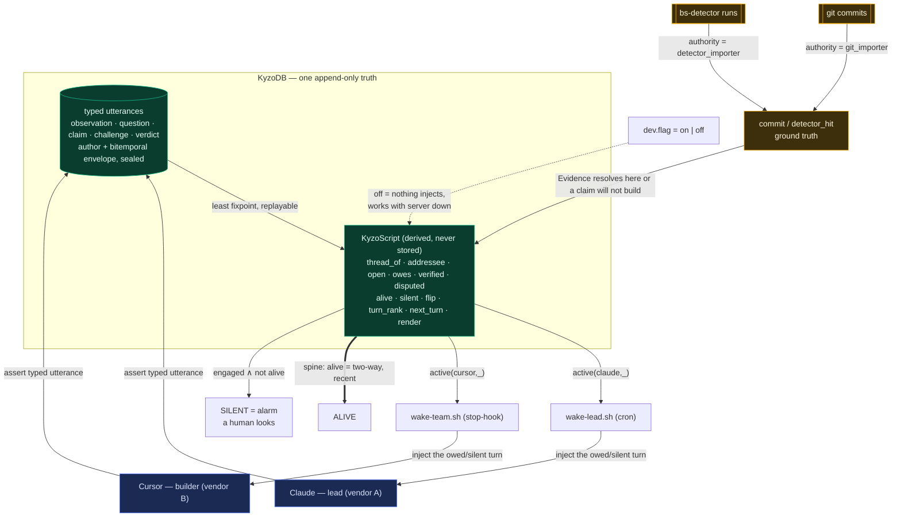

# KyzoPlan — Agent Collaboration

Two cross-vendor agents (Claude lead, Cursor team) collaborate through one append-only KyzoDB relation. The system is an ontology plus KyzoScript rules that runs inside KyzoDB. Its design job is to make the lead's failure modes — softening a verdict, claiming done without proof, self-approving, going silent — records that will not construct, not behaviors a prompt asks against.

## The principle

Encode honesty in the types so the failure modes are load errors, not requests. Everything that can be a type constraint is one; everything that can be a derived rule is one; the prompts carry only what no type can hold. A prompt that asks an agent to be honest is the exact surface training wriggles out of, so the surface is removed.

## File tree

```
.kyzo/
├── kyzo-plan-agent-collaboration.md   # this doc
└── collab/
    ├── ontology.kyzo     # typed kinds, evidence, the ground-truth relations
    ├── rules.kyzo        # KyzoScript: open, owes, verified, disputed, alive, silent, flip, active
    ├── bite.kyzo         # deny/pass fixtures that must refuse or classify — dogfood the type safety
    ├── dev.flag          # the switch — one word: on | off
    ├── lead.prompt.md    # Claude role: only what the types cannot hold
    ├── team.prompt.md    # Cursor role: only what the types cannot hold
    ├── wake-lead.sh      # Claude cron: run active(claude,_), inject or park
    └── wake-team.sh      # Cursor stop-hook: run active(cursor,_), inject or park
```

## Parts

1. **Typed kinds** — each utterance kind is its own record with its own required fields; no shared row, no nullable body.
2. **Proof-carrying evidence** — `Evidence` constructs only from a resolved git commit or detector hit; a claim without it will not build.
3. **Authority-gated ground truth** — `commit` and `detector_hit` are writable only by the importers; agents cite facts, never mint them.
4. **Derived rules** — `open`, `owes`, `verified`, `disputed`, `alive`, `silent`, `flip`; nothing derived is stored, so nothing can be costumed.
5. **The spine** — `alive` is the monitored state; `silent` on an engaged thread is the alarm; going quiet is never success.
6. **One switch** — `dev.flag`, conjoined into every wake rule; `off` rests both agents even with the server down.
7. **Two thin wakeups** — one query each, then inject or park; no logic in bash.
8. **Two role prompts** — cross-vendor, honest-adversarial; carry stance and proactivity, restate no rule the types already enforce.

## Ontology (ontology.kyzo)

Author, authority, and both time axes come from the KyzoRecord envelope. They are sealed, so they are never modeled as columns. `Text` is a newtype over private bytes whose `admit` constructor refuses empty or malformed input; `AgentId` is closed; every `Ref` is a handle that refuses unless it resolves to an existing record.

```
type AgentId  = Claude | Cursor                      ; closed — cannot address a nonexistent agent
type Ruling   = Confirmed | Rejected                 ; no gradient — a verdict cannot be softened
type Text     = admit(bytes) -> Text | refuse        ; empty/malformed refuses at construction

; Evidence carries its proof. Each constructor refuses unless the external fact resolves.
type Evidence =
    | Commit(sha: Sha)            requires resolves_commit(sha)
    | Hit(run: RunId, check: CheckId, file: Text, line: U64)
                                 requires resolves_hit(run, check, file, line)

; One kind per record. Claim and Verdict cannot exist without Evidence — it is a field, not an option.
relation observation { about: Ref,       note:    Text }
relation question    { to: AgentId,       about: Ref,     ask:     Text }
relation claim       { built: WorkRef,    asserts: Text,  cites:   Evidence }
relation challenge   { against: UttId,    because: Text,  cites:   Evidence }
relation verdict     { on: ClaimId,       ruling:  Ruling, cites:  Evidence }

; Ground truth. authority(...) refuses any agent-authored write; only the importers hold it.
relation commit       { sha: Sha, ... }              authority = git_importer
relation detector_hit { run: RunId, check: CheckId, file: Text, line: U64 }
                                                     authority = detector_importer

resolves_commit(sha)                :- commit(sha, _).
resolves_hit(run, check, file, line):- detector_hit(run, check, file, line).
```

## Rules (rules.kyzo)

Negation is stratified: every negated head sits strictly above what it negates, which is what KyzoScript's unique fixpoint requires. An unstratified rule is a load error — that error is the proof the logic is sound.

```
; --- obligation: owing is the ABSENCE of an answer, derived, never stored ---
answered(U)  :- verdict(V), V.on = U.
answered(U)  :- question(U, _), reply(R), R.answers = U.
open(U)      :- kind_needs_reply(U), not answered(U).
owes(A, U)   :- open(U), addressee(U, A).

kind_needs_reply(U) :- question(U, _).
kind_needs_reply(U) :- claim(U, _).
kind_needs_reply(U) :- challenge(U, _).

; --- verification: cross-agent AND externally grounded; self-verify cannot derive ---
verified(C)  :- claim(C, _), author(C, A),
                verdict(V), V.on = C, V.ruling = Confirmed,
                author(V, R), R \= A,                 ; different agents, enforced in the join
                cites(V, E), evidence_resolves(E).     ; E already resolved at construction

disputed(C)  :- verdict(V), V.on = C, V.ruling = Rejected.
owes(A, C)   :- disputed(C), claim(C, _), author(C, A). ; a rejected claim reopens on its author

; --- the spine: recent, two-way talk is alive; silence on an engaged thread is the alarm ---
last_at(T, When)  :- max{ When : utterance_in(T, U), sys_time(U, When) }.
two_sided(T)      :- utterance_in(T, U1), author(U1, Claude),
                     utterance_in(T, U2), author(U2, Cursor),
                     within(U1, U2, WINDOW).
alive(T)          :- last_at(T, When), now() - When < QUIET_BOUND, two_sided(T).
engaged(T)        :- utterance_in(T, U), open(U).
silent(T)         :- engaged(T), not alive(T).         ; fires -> a human looks; never success

; --- research metric: a claim that was confirmed then rejected, answered as-of ---
flip(C)      :- verified(C) as_of T1, disputed(C) as_of T2, T2 > T1.

; --- threads are DERIVED by reachability, not assigned by a shim (recursive Datalog) ---
refers(U, V) :- verdict(U),    V = U.on.
refers(U, V) :- challenge(U),  V = U.against.
refers(U, V) :- reply(U),      V = U.answers.
linked(U, V) :- refers(U, V).
linked(U, V) :- refers(V, U).
linked(U, W) :- linked(U, V), linked(V, W).        ; transitive closure = connected component
thread_of(U, T) :- T = min{ V : linked(U, V) } or (no links, T = U).  ; canonical id = min in component
utterance_in(T, U) :- thread_of(U, T).
engaged_thread(T)  :- utterance_in(T, U), open(U).

; --- addressee is DERIVED per kind, not assumed ---
other(Claude, Cursor).  other(Cursor, Claude).
addressee(U, A) :- question(U, _),  A = U.to.
addressee(U, A) :- claim(U, _),     author(U, W), other(W, A).   ; a claim is owed to the counterparty
addressee(U, A) :- challenge(U, _), V = U.against, author(V, A). ; a challenge is owed to whom it challenges

; --- the turn to inject is DERIVED and RANKED, not chosen in bash ---
turn_rank(A, U, 0) :- addressee(U, A), thread_of(U, T), silent(T).   ; a dying thread first
turn_rank(A, U, 1) :- owes(A, U), disputed(U).                        ; then a reopened claim
turn_rank(A, U, 2) :- owes(A, U).                                     ; then the oldest owed
next_turn(A, U) :- turn_rank(A, U, R),
                   R = min{ R2 : turn_rank(A, _,  R2) },
                   U = min{ U2 : turn_rank(A, U2, R) }.               ; deterministic tie-break by id
; the injection STRING is derived too — bash never templates
render(A, "SILENCE " ++ T)          :- next_turn(A, U), thread_of(U, T), silent(T).
render(A, U.kind ++ ": " ++ U.text) :- next_turn(A, U), not silent(thread_of(U)).

; --- the gate: every wake conjoins the switch ---
active(A, U) :- dev(on), next_turn(A, U).
```

## Bite fixtures (bite.kyzo)

Prove the refusals fire before the system is trusted, same discipline as the detector. Each deny row must refuse to load; each pass row must classify.

```
deny  claim_without_evidence   : claim{ cites: <absent> }            expect refuse(construct)
deny  claim_dangling_commit    : claim{ cites: Commit("0000…") }     expect refuse(resolves_commit)
deny  self_verdict             : verdict{ on: C, author = author(C) } expect refuse(R \= A)
deny  verdict_unresolved_hit   : verdict{ cites: Hit(run, chk, f, l) not in detector_hit }
                                                                     expect refuse(resolves_hit)
deny  agent_writes_ground_truth: commit{...} authored by Claude      expect refuse(authority)
deny  unstratified_negation    : owes depends on not owes            expect refuse(load)
pass  grounded_cross_verdict   : claim + verdict(R\=A, resolved)      expect verified(C)
pass  reopened_on_reject       : verdict(Rejected)                    expect disputed(C) ∧ owes(author,C)
```

## Diagram



## Failure modes made unconstructable

| Failure mode | What removes it | Mechanism |
| --- | --- | --- |
| Softening a verdict | `Ruling = Confirmed \| Rejected` | no gradient value exists to hedge into |
| "Done" without proof | `claim.cites: Evidence` required | the record will not construct without a resolved fact |
| Self-approval / cover | `R \= A` in `verified` | a self-verdict cannot derive `verified` |
| Faking evidence | `authority` on ground-truth relations | agents cite importer facts, cannot write them |
| Count-shrinking / costume | nothing derived is stored | a costume changes no stored conclusion; `verified` is re-derived |
| Fear / hedge in dialogue | no field holds a hedge | an utterance cites, or it is a note; there is no "I think maybe" slot |
| Silent stall | `silent(T)` is the alarm | going quiet is a named failure state, not a resting success |
| Sycophancy | no `agree` primitive | agreement is not representable, so it cannot spread or close a thread |

## Architecture

**The spine is the conversation.** `alive(thread)` — recent, two-way — is the monitored state; `silent` is the alarm. This is the deliberate inversion of a queue where clearing debts and going quiet is the resting state; that shape produced days of cron-smacking and no work.

**Obligation is absence.** `owes(agent, U)` is the absence of an answer to an open utterance addressed to that agent — a few lines of Datalog replacing the whole mailbox/watermark/monitor stack. Being owed is a live query, never a stored "unread."

**Verification is grounded and cross-agent.** `verified` needs a verdict from a different author citing evidence that resolves against git or the detector. Because `Claim` and `Verdict` already carry resolved `cites` and `R \= A` is enforced in the join, there is no path to `verified` without two distinct agents and two real external facts.

**Append-only is the discipline, and the one thing not to violate.** No mutable `status` column, ever. A correction is a new utterance. Adding a stored status is the single change that reintroduces every fraud, because it creates a boolean to desync from reality; it is forbidden.

**Everything computable is derived, not scripted.** Thread membership is recursive reachability (`linked`, `thread_of`), addressee is derived per kind, and the turn to inject is ranked and rendered inside the rules (`turn_rank`, `next_turn`, `render`). The wake script runs one query — `render(me, Text)` — and pipes the string; it has no ranking, no templating, no conditional beyond nonempty. Logic in bash is logic that escaped the rules.

**The wake is two-sided by necessity.** A stopped agent cannot wake itself. Cursor's infinite stop-hook parks until `active(cursor,_)`, then injects and continues the same thread; Claude's cron wakes on `active(claude,_)`. What legitimately stays outside the engine is only the three transcription shims (git/detector/agent-text → relations), the `dev.flag` file so the kill switch survives a dead server, and the OS trigger itself.

**The prompts carry only the un-typeable.** Proactivity and stance cannot be a rule; a rule that forces talk manufactures fake talk. The two cross-vendor prompts set the agents to volunteer observations, hunt each other's error, distrust by default, and change their mind on evidence. They restate no constraint the types enforce — a prompt line that duplicates a type is deleted, because that is where soft language creeps back.

**The one thing above the code:** the agents talk as people competing to make each other and the work better, or the power is lost. The types make the lie unconstructable and the silence loud; they cannot make the dialogue happen. That is chosen, every turn.
